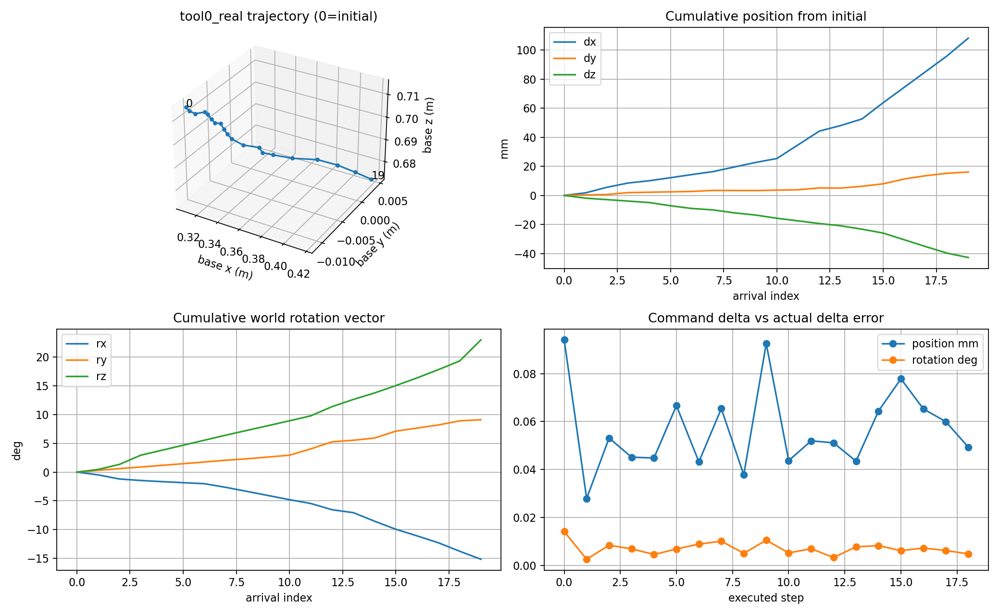
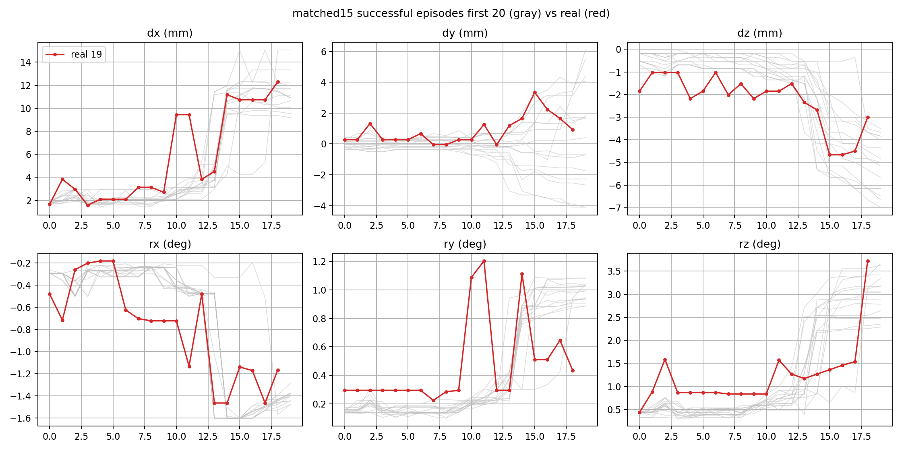
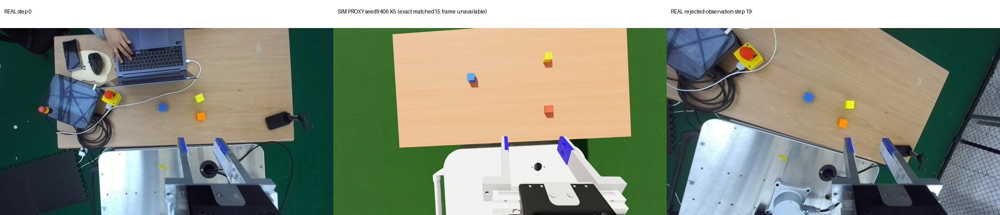

# policy_movej 20261113_114039 오프라인 분석

분석 대상: `reports/live/20261113_091859/policy_movej/20261113_114039/`  
실기/ROS 호출 없이 저장 로그와 번들 내 matched15 evidence만 사용했다. 실행은 19개 MoveJoint를 완료했고, 20번째 추론 action은 관절 보간 경로의 sample 13–19에서 `SINGULARITY_APPROACH`가 검출되어 이동 없이 거부됐다.

## 1. 실행 정확도

오차 정의는 위치 `||(actual Δp)-(command Δp)||`, 회전 `angle(Exp(actual ω)·Exp(command ω)^-1)`이다. 둘 다 각 step의 시작→도착 변화량 비교다.

| 항목 | p50 | max |
|---|---:|---:|
| 위치 차이 | 0.0520 mm | 0.0941 mm |
| 회전 차이 | 0.0069° | 0.0141° |

관절 도착 오차의 전체 114개 성분 중 절대값 p50/max는 `0.0034° / 0.0112°`다.

## 2. tool0_real 궤적(base 좌표계)

자세는 base 기준 XYZ Euler이며, 누적 회전은 초기 자세에 대한 world rotvec이다. row 0은 첫 명령 직전 복원 자세, row 1–19는 각 MoveJoint 도착 자세다.

| idx | base position xyz (m) | base Euler xyz (°) | 누적 xyz (mm) | 누적 rotvec xyz (°) |
|---:|---|---|---|---|
| 0 | [0.308727, -0.011233, 0.715420] | [-155.589, 1.572, -93.184] | [0.00, 0.00, 0.00] | [0.00, 0.00, 0.00] |
| 1 | [0.310458, -0.010908, 0.713516] | [-155.869, 1.073, -92.739] | [1.73, 0.33, -1.90] | [-0.48, 0.30, 0.45] |
| 2 | [0.314284, -0.010642, 0.712511] | [-156.135, 0.347, -91.861] | [5.56, 0.59, -2.91] | [-1.20, 0.60, 1.33] |
| 3 | [0.317239, -0.009318, 0.711506] | [-156.423, 0.086, -90.272] | [8.51, 1.91, -3.91] | [-1.46, 0.88, 2.92] |
| 4 | [0.318823, -0.009062, 0.710477] | [-156.719, -0.113, -89.405] | [10.10, 2.17, -4.94] | [-1.66, 1.17, 3.79] |
| 5 | [0.320916, -0.008791, 0.708284] | [-157.016, -0.289, -88.537] | [12.19, 2.44, -7.14] | [-1.84, 1.45, 4.66] |
| 6 | [0.323057, -0.008514, 0.706405] | [-157.323, -0.460, -87.664] | [14.33, 2.72, -9.01] | [-2.02, 1.75, 5.54] |
| 7 | [0.325111, -0.007805, 0.705430] | [-157.647, -1.075, -86.788] | [16.38, 3.43, -9.99] | [-2.65, 2.06, 6.40] |
| 8 | [0.328283, -0.007853, 0.703386] | [-157.918, -1.762, -85.940] | [19.56, 3.38, -12.03] | [-3.35, 2.31, 7.24] |
| 9 | [0.331404, -0.007901, 0.701888] | [-158.260, -2.458, -85.091] | [22.68, 3.33, -13.53] | [-4.07, 2.61, 8.07] |
| 10 | [0.334126, -0.007618, 0.699677] | [-158.623, -3.150, -84.233] | [25.40, 3.61, -15.74] | [-4.79, 2.93, 8.90] |
| 11 | [0.343555, -0.007342, 0.697882] | [-159.777, -3.751, -83.327] | [34.83, 3.89, -17.54] | [-5.45, 4.03, 9.77] |
| 12 | [0.353003, -0.006082, 0.696040] | [-161.119, -4.717, -81.657] | [44.28, 5.15, -19.38] | [-6.54, 5.25, 11.35] |
| 13 | [0.356816, -0.006189, 0.694501] | [-161.488, -5.142, -80.366] | [48.09, 5.04, -20.92] | [-7.04, 5.52, 12.61] |
| 14 | [0.361346, -0.004953, 0.692159] | [-162.041, -6.534, -79.132] | [52.62, 6.28, -23.26] | [-8.53, 5.91, 13.73] |
| 15 | [0.372549, -0.003273, 0.689468] | [-163.441, -7.743, -77.687] | [63.82, 7.96, -25.95] | [-9.92, 7.10, 15.02] |
| 16 | [0.383285, 0.000081, 0.684821] | [-164.196, -8.738, -76.215] | [74.56, 11.31, -30.60] | [-11.08, 7.64, 16.35] |
| 17 | [0.394007, 0.002321, 0.680165] | [-164.995, -9.743, -74.628] | [85.28, 13.55, -35.25] | [-12.27, 8.18, 17.78] |
| 18 | [0.404752, 0.003973, 0.675662] | [-166.046, -10.967, -72.902] | [96.03, 15.21, -39.76] | [-13.74, 8.89, 19.29] |
| 19 | [0.417020, 0.004872, 0.672657] | [-166.854, -11.923, -69.025] | [108.29, 16.10, -42.76] | [-15.13, 9.09, 22.95] |

최종 누적 위치는 `[108.29, 16.10, -42.76] mm`, 직선거리는 `117.54 mm`다. 최종 누적 world rotvec은 `[-15.13, 9.09, 22.95]°`.

### base 축과 카메라/작업공간 방향

- A0509 base의 +x는 로봇에서 테이블 안쪽으로 멀어지는 방향이다. real-home 첫 영상에서는 대략 영상 위쪽이다.
- +y는 +z를 위로 둔 오른손 좌표계에서 로봇의 왼쪽이며, 첫 영상에서는 대략 영상 왼쪽이다.
- -z는 수직 아래, 즉 테이블 면으로 내려가는 방향이다. 이는 영상 평면의 일정한 좌/우/상/하가 아니라 깊이 방향이다.
- 카메라가 손목/팔과 함께 움직이고 영상이 회전하므로 이 pixel 방향 대응은 **첫 real-home frame에서만 근사적**이다. step 19 영상에는 시점과 roll이 크게 바뀌어 base 축을 고정 pixel 축으로 해석하면 안 된다.

## 3. matched15 성공 episode와 action 비교

정확한 evidence JSON의 성공 15 episode 각각 첫 20 action(총 300개)을 사용했다. blue target 5 episode(100개)도 별도로 계산했다. 단위는 Δp=mm, ω=degree/step이다.

| 성분 | matched15 전체 mean [min,max] | matched15 blue mean [min,max] | real 19 mean [min,max] |
|---|---:|---:|---:|
| dx | 5.087 [1.410,15.058] | 5.032 [1.497,11.690] | 5.698 [1.583,12.294] |
| dy | -0.001 [-4.104,6.101] | 0.300 [-4.104,5.512] | 0.847 [-0.048,3.353] |
| dz | -1.667 [-6.978,-0.029] | -2.064 [-6.978,-0.195] | -2.250 [-4.662,-1.022] |
| rx | -0.694 [-1.600,-0.195] | -0.732 [-1.600,-0.234] | -0.789 [-1.464,-0.182] |
| ry | 0.409 [0.100,1.087] | 0.428 [0.100,1.087] | 0.472 [0.226,1.202] |
| rz | 1.202 [0.313,3.656] | 1.312 [0.313,3.656] | 1.216 [0.440,3.719] |

| 집합 | 첫 구간 누적 Δp mean xyz (mm) | 합성 누적 rotvec mean xyz (°) |
|---|---|---|
| matched15 전체, episode별 20 step 평균 | [101.74, -0.01, -33.34] | [-13.90, 7.98, 24.10] |
| matched15 blue, episode별 20 step 평균 | [100.65, 6.00, -41.29] | [-14.64, 8.31, 26.32] |
| real, 19 executed step | [108.25, 16.09, -42.75] | [-15.13, 9.09, 22.95] |

### 관찰점

- **Δx 증가:** real Δx는 step index에 대해 선형 기울기 `0.595 mm/step`이고, 첫 9 step 평균 `2.514 mm`에서 마지막 10 step 평균 `8.563 mm`로 증가했다. matched15 전체 첫 20의 Δx 평균은 `5.087 mm`다.
- **rz 누적:** real 단순 합은 `23.103°`, 비가환 합성 후 rotvec z는 `22.946°`다. matched15 episode별 첫 20 단순 rz 합 평균은 `24.044°`다.
- **ry 반복 token:** real의 최빈 ry token은 `0.2957°`로 19회 중 10회이며 최장 동일-token 연속은 7회다. 그러나 이는 endpoint가 아니다. real ry 최소/최대 endpoint 횟수는 `0/1`회뿐이다. matched15 첫 300 action의 최빈 ry token은 `0.1405°`로 39회이고 episode 내 최장 동일-token 연속도 7회였으며, ry endpoint는 `0/0`회다. 즉 반복 양자화 token 자체는 sim 성공에서도 나타나지만, real은 더 큰 양의 ry bin에 집중됐다.
- **gripper:** real 19 step은 모두 raw gripper `0.001961`(<0.5, open)로 닫힘이 한 번도 없었다. matched15 15/15 episode는 결국 close를 출력했고 최초 close step 범위/median은 `50/55.0/62`다. 첫 20 step 안에 닫힌 episode 수는 `0/15`다. real은 접근 초기 구간과 비교하면 아직 닫힘 전일 수 있지만, 실행은 singularity precheck로 더 진행되지 못했다.

## 4. 입력 이미지 비교

**중요한 provenance 제한:** matched15 evidence의 `initial_frame`은 `D:\codex_staging\...\episode_001_red_initial.jpg`를 가리키며 이 Linux bundle에는 해당 파일이 없다. 가운데 영상은 동일 seed9406이지만 phase9 K5 sim baseline의 `episode_001_red_initial.jpg`인 **시각 참고 proxy**다. 정확한 matched15 첫 frame으로 가장하면 안 된다.

- real은 1280×720이고 책상 외에 노트북, 비상정지 버튼, 케이블, 작업자 손, 금속 로봇 셀과 실제 광택/그림자가 넓게 들어온다. proxy sim은 깨끗한 테이블·바닥·로봇만 보인다.
- sim proxy는 테이블이 영상 대부분을 채우는 정돈된 top-oblique 시점이고 큐브가 크게 분리되어 있다. real 첫 frame은 더 넓은 주변 환경과 clutter가 포함되며 blue cube는 중앙 부근이나 물체 pixel 비율이 작다.
- real에는 orange cube도 있어 matched15의 red/yellow/blue 세 색 scene과 물체 구성이 다르다. 이번 지시 대상 blue 자체는 matched15 허용 색이다.
- real 조명은 노출 편차, 반사, 그림자와 실제 목재 texture가 강하다. sim proxy는 균일하고 포화된 색, 단순 그림자다.
- 마지막 관측(step 19, 실제로는 20번째 추론 후 이동 거부)은 카메라/팔 자세 변화로 초기보다 테이블이 확대·회전되고 clutter 일부가 프레임 밖으로 나갔다. 따라서 같은 물체도 학습 시점과 다른 perspective/scale에 놓인다.

## 5. arm 끝 token

차원 순서는 `[dx,dy,dz,rx,ry,rz]`, 각 cell은 `min/max 횟수`, 최대 streak는 min/max별 최대값이다. gripper는 endpoint 감시에서 제외된다.

| 차원 | 실행 19 step endpoint min/max | 실행 최대 streak min/max | matched15 첫300 min/max |
|---|---:|---:|---:|
| dx | 0/0 | 0/0 | 0/4 |
| dy | 0/0 | 0/0 | 0/0 |
| dz | 0/0 | 0/0 | 0/0 |
| rx | 0/0 | 0/0 | 36/0 |
| ry | 0/1 | 0/1 | 0/0 |
| rz | 0/1 | 0/1 | 0/0 |

실행 step별 endpoint:

| step | min dimensions | max dimensions | streak nonzero |
|---:|---|---|---|
| 0 | - | - | - |
| 1 | - | - | - |
| 2 | - | - | - |
| 3 | - | - | - |
| 4 | - | - | - |
| 5 | - | - | - |
| 6 | - | - | - |
| 7 | - | - | - |
| 8 | - | - | - |
| 9 | - | - | - |
| 10 | - | - | - |
| 11 | - | ry | ry:max=1 |
| 12 | - | - | - |
| 13 | - | - | - |
| 14 | - | - | - |
| 15 | - | - | - |
| 16 | - | - | - |
| 17 | - | - | - |
| 18 | - | rz | rz:max=1 |

추가로 이동되지 않은 20번째 추론(step 19 prediction)의 endpoint는 min/max 모두 없음이다. 실행 종료 원인은 endpoint가 아니라 `['PATH_13:SINGULARITY_APPROACH', 'PATH_14:SINGULARITY_APPROACH', 'PATH_15:SINGULARITY_APPROACH', 'PATH_16:SINGULARITY_APPROACH', 'PATH_17:SINGULARITY_APPROACH', 'PATH_18:SINGULARITY_APPROACH', 'PATH_19:SINGULARITY_APPROACH']`다. endpoint policy는 `log_only`였다.

## 출처

- real: `reports/live/20261113_091859/policy_movej/20261113_114039/steps.jsonl`, `predictions.jsonl`, `summary.json`, model_input JPEG
- matched15 actions: `/home/ubuntu/a0509_vla_linux_field_bundle_20260903/validation/evidence/vanilla/success_profile_s1_balanced_step8130_matched15_k1_seed9406_15ep.json`
- sim image proxy: `/home/ubuntu/a0509_vla_linux_field_bundle_20260903/lhj/phase9_sim_policy_shadow_replay/01_sim_policy_rollout_episode4_sim_baseline/episode4_sim_baseline_redprompt_k5_seed9406_1ep_frames/episode_001_red_initial.jpg`
- pose: logged target joint + arrival joint error를 J1–J6 순서로 합산 후 PyKDL FK(link_6)와 tool0_real 변환 적용. 초기 pose는 첫 arrival pose와 첫 actual_delta를 역적용해 복원.
