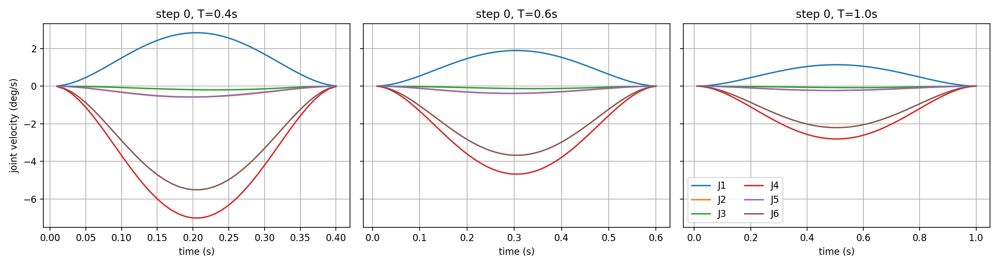
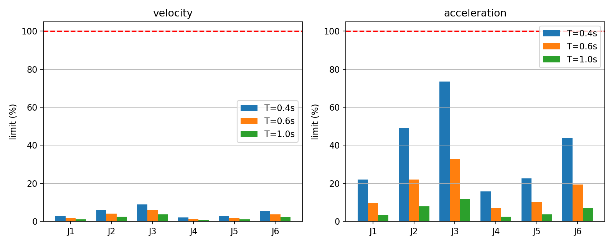

# ServoJ offline replay

- Source: `/home/ubuntu/a0509_vla_linux_field_bundle_20260903/lhj/phase12_real_policy_rollout/rollout_ver2/reports/live/20261113_091859/policy_movej/20261113_140038`
- Actions: 222; 100 Hz; sigma-min candidate 0.0803
- Offline only; no ROS import or command publication.

| T (s) | accepted / 222 | IK | margin | sigma | velocity | acceleration | precompute p50/p99/max (s) |
|---:|---:|---:|---:|---:|---:|---:|---|
| 0.4 | 222 / 222 | 0 | 0 | 0 | 0 | 0 | {'p50': 0.0444631095015211, 'p99': 0.06296566080098272, 'max': 0.06624439399456605} |
| 0.6 | 222 / 222 | 0 | 0 | 0 | 0 | 0 | {'p50': 0.06232832299428992, 'p99': 0.08627672333503142, 'max': 0.09352731599938124} |
| 1.0 | 222 / 222 | 0 | 0 | 0 | 0 | 0 | {'p50': 0.09926588549569715, 'p99': 0.13476248250575737, 'max': 0.13614041701657698} |

## Maximum dynamics

Percentages use the configured candidate limits; a value over 100% is a whole-segment rejection, never clamped.

- T=0.4: velocity % `[2.66, 6.01, 8.96, 1.95, 2.78, 5.4]`, acceleration % `[21.9, 49.21, 73.47, 15.65, 22.65, 43.63]`
- T=0.6: velocity % `[1.77, 4.01, 5.98, 1.3, 1.86, 3.6]`, acceleration % `[9.75, 21.89, 32.69, 6.97, 10.08, 19.44]`
- T=1.0: velocity % `[1.06, 2.41, 3.59, 0.78, 1.11, 2.16]`, acceleration % `[3.51, 7.89, 11.78, 2.51, 3.64, 7.01]`

## Endpoint comparison

The action-target comparison is the required numerical identity. The recorded-command comparison uses FK of the MoveJ target joints and therefore exposes its earlier IK tolerance. Actual arrival is reconstructed per step as recorded target joint plus `arrival_joint_error_deg` (not by accumulating deltas).

- T=0.4: action target `{'position_mm': {'p50': 0.0, 'p99': 0.0, 'max': 0.0}, 'rotation_deg': {'p50': 4.432873645737633e-15, 'p99': 1.6704154769016204e-14, 'max': 2.0477630848247675e-14}}`; recorded MoveJ command FK `{'position_mm': {'p50': 0.00012702699566237273, 'p99': 0.03212978755817165, 'max': 0.2837638997198756}, 'rotation_deg': {'p50': 4.143658832782175e-05, 'p99': 0.004554558465462314, 'max': 0.03335461561179788}}`; MoveJ actual `{'position_mm': {'p50': 0.046004306176218056, 'p99': 0.1207593921499873, 'max': 0.3042833712427168}, 'rotation_deg': {'p50': 0.005015019809118033, 'p99': 0.01576510976847717, 'max': 0.03687330914797066}}`
- T=0.6: action target `{'position_mm': {'p50': 0.0, 'p99': 0.0, 'max': 0.0}, 'rotation_deg': {'p50': 4.432873645737633e-15, 'p99': 1.6704154769016204e-14, 'max': 2.0477630848247675e-14}}`; recorded MoveJ command FK `{'position_mm': {'p50': 0.00012702699566237273, 'p99': 0.03212978755817165, 'max': 0.2837638997198756}, 'rotation_deg': {'p50': 4.143658832782175e-05, 'p99': 0.004554558465462314, 'max': 0.03335461561179788}}`; MoveJ actual `{'position_mm': {'p50': 0.046004306176218056, 'p99': 0.1207593921499873, 'max': 0.3042833712427168}, 'rotation_deg': {'p50': 0.005015019809118033, 'p99': 0.01576510976847717, 'max': 0.03687330914797066}}`
- T=1.0: action target `{'position_mm': {'p50': 0.0, 'p99': 0.0, 'max': 0.0}, 'rotation_deg': {'p50': 4.432873645737633e-15, 'p99': 1.6704154769016204e-14, 'max': 2.0477630848247675e-14}}`; recorded MoveJ command FK `{'position_mm': {'p50': 0.00012702699566237273, 'p99': 0.03212978755817165, 'max': 0.2837638997198756}, 'rotation_deg': {'p50': 4.143658832782175e-05, 'p99': 0.004554558465462314, 'max': 0.03335461561179788}}`; MoveJ actual `{'position_mm': {'p50': 0.046004306176218056, 'p99': 0.1207593921499873, 'max': 0.3042833712427168}, 'rotation_deg': {'p50': 0.005015019809118033, 'p99': 0.01576510976847717, 'max': 0.03687330914797066}}`

## Failure locations

Full diagnostics are in `analysis.json`.

- T=0.4: `[]`
- T=0.6: `[]`
- T=1.0: `[]`

